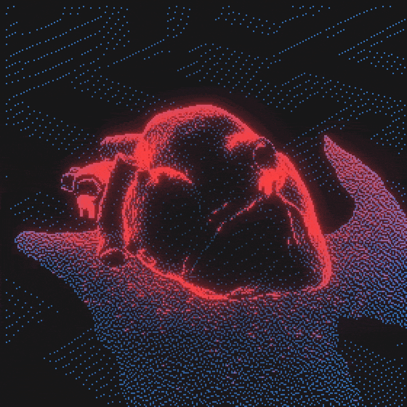
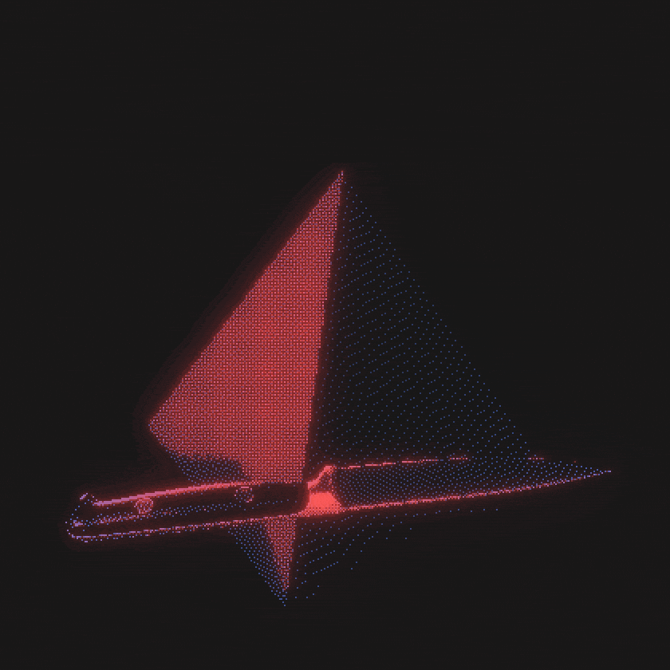

<!-- Nome -->

<!-- Subtítulo -->

<!-- GIFs -->

  
  
  

<!-- Objetivos -->

<ul>
  <li>Aprender sobre Tecnologias</li>
  <li>Ter capacidade de dar vida as minhas ideias</li>
</ul>

<!-- Tecnologias -->

<!-- Ferramentas -->

<!-- Estatísticas -->

<!-- Redes sociais -->

  
  
  

<!-- Rodapé -->

